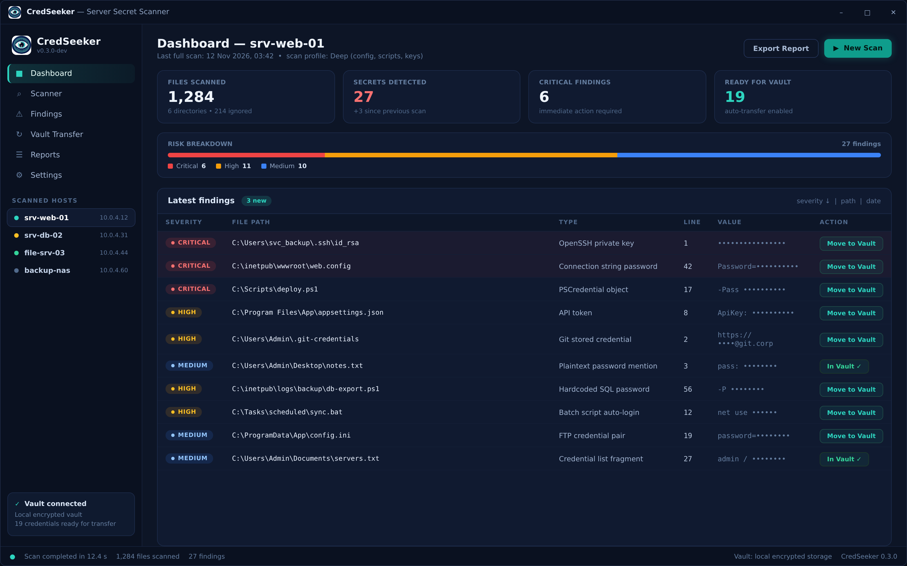

# CredSeeker
> CredSeeker for Windows - find and vault the secrets your servers should never keep in plain sight

[](https://github.com/your-username/credseeker)  [](LICENSE)

<p align="center"></p>

---

## About
CredSeeker is a free, open-source **secret scanner** for Windows servers, built in **Rust**. It scans the file system of a server for hardcoded credentials - passwords, private keys, API tokens and connection strings - and points out the files that should be moved into a secure, encrypted **vault** before an attacker finds them first. Findings can be reviewed in the CLI, exported as reports and transferred into an encrypted vault in a single step.

### Why you need a secret scanner
Servers accumulate secrets. A connection string in `web.config`, a password in a deployment script, an SSH key in a service account profile - every administrator knows how these pile up over years of "temporary" solutions. The problem is rarely that the credential exists; it is that nobody remembers *where* it lives. If a single machine is breached, every plaintext credential on its disk becomes a stepping stone to the rest of your network.

Without a secret scanner, such as CredSeeker, auditing a server means grepping folders by hand and hoping you guessed the right file names. If you can point at a plaintext password on your server right now, that is a finding. Ideally your servers hold no credentials in plain text at all - CredSeeker shows you which files violate that rule and helps you move them into a vault.

### Precautions
CredSeeker finds and helps you relocate secrets, but the vault you move them into is only as strong as its weakest component - and this is very often the primary password used to lock and unlock the vault. Follow these basic guidelines to ensure that your vault is safe even if exposed:
* Choose a **unique** password that is not used elsewhere
* Use a highly-varied set of different characters - such as alpha-numeric, symbols and spaces
* Use a long password - the longer the better
* Never store the vault password in a file on the server CredSeeker scans
* Never share your password with anyone

_It is very important to note that no one associated with CredSeeker will ever request your personal vault or its primary password. Do not share it or any of its related details with anyone. Developers or contributors working with CredSeeker may request **example** scan reports created via your system to try and reproduce issues, but please ensure to never use your real passwords or store actual credentials within such reports._

### Versions
CredSeeker is under active development - the current release line is **0.3**. The CLI scanner is the stable interface today; the desktop GUI (shown in the preview above) is in development and not yet published.
CredSeeker is built on the Rust stable toolchain (1.75 or greater) - no other platform is officially supported.

### Operating Systems
CredSeeker is officially supported on:
* Windows 10 / 11 (x64)¹

## Portability
CredSeeker provides a portable **Windows** version. Look for the release with the name `CredSeeker-win-x64-0.3.0-portable.zip` where `0.3.0` is the version and `x64` is the architecture. The archive contains a standalone executable that requires no installation - just extract and run.

To make the most of the portable version, some environment variables are required:

| Environment Variables   | Description |
|------------------------|-------------|
| `CREDSEEKER_HOME_DIR`   | If provided CredSeeker will use this path for saving __configurations__, __user settings__ or even __temporary files__ |
| `CREDSEEKER_CONFIG_DIR` | Stores __user settings__, not always needed but can be used to change config location or will default to CREDSEEKER_HOME_DIR `Optional: Only activates if CREDSEEKER_HOME_DIR is provided` |
| `CREDSEEKER_TEMP_DIR`   | Same as CREDSEEKER_CONFIG_DIR but stores __temporary files__ `Optional: Only activates if CREDSEEKER_HOME_DIR is provided` |

### Sample `CredSeekerLauncher.bat` for Windows portable executable
> This example stores user settings and cache on the portable folder, but stores temporary files on the host PC.

```bat
@ECHO OFF
if not exist "%~dp0CredSeeker" mkdir "%~dp0CredSeeker"
set "CREDSEEKER_HOME_DIR=%~dp0CredSeeker"
set "CREDSEEKER_TEMP_DIR=%temp%"
start %~dp0credseeker.exe %*
```

## Configuration
Configuration files are stored in OS-specific locations.

### Command-Line arguments
The following arguments can be provided to CredSeeker, but are all optional.
| Argument              | Description                           |
|-----------------------|---------------------------------------|
| `--scan <PATH>`       | Starts a scan of the given directory or drive. |
| `--profile <NAME>`    | Scan profile to use: `quick` (default) or `deep`. |
| `--report <FILE>`     | Writes the scan report to the given file instead of stdout. |
| `--exclude <PATTERN>`  | Excludes files or directories matching the pattern. Repeatable. |
| `--vault <PATH>`      | Targets the vault that findings will be transferred into. |
| `--no-color`          | Disables colored console output. |

### App config
Application configuration.
* Windows: `$APPDATA/CredSeeker/config.json`

### Vault storage
Storage of connected vaults (not actual vault contents).
* Windows: `$LOCALAPPDATA/CredSeeker/vaults.json`

### Scan reports
Reports generated by completed scans.
* Windows: `$USERPROFILE/Documents/CredSeeker/Reports`

### Logs
Logs are written for all app sessions.
* Windows: `$LOCALAPPDATA/CredSeeker/Log`

_Note that logs for portable Windows applications will be written to the same directory that the executable resides in._

## Published Applications
You can view the current releases on the [CredSeeker releases page](https://github.com/your-username/credseeker/releases). Under each release are some assets - the installers and portable archives for the platforms CredSeeker supports. When installing or downloading, make sure to pick the right operating system and architecture for your machine.

_Note that at this time, CredSeeker only supports x64 (64 bit) machines._

### Windows
We provide an **installer** build for Windows, because it is the most desirable format for us to release: it registers file associations, configures scheduled scan options and supports auto-updating - a crucial feature (we feel) for a security application. The portable **zip** does not.
**Important:** early releases are not yet code-signed, so Windows SmartScreen may show a warning on first launch. Choose _More info_ → _Run anyway_, or verify the release SHA-256 checksum published with each release. This warning disappears once signed builds are published.
We won't be supporting formats like MSI packages in the early stages as they do not align with our requirements. Issues requesting these formats will be closed immediately. Discussion on topics like this should be started on other social channels.

## Development
To begin developing features or bug-fixes for CredSeeker, make sure that you first have Rust stable **1.75** or greater installed with Cargo (via [rustup](https://rustup.rs)).

Once cloned, build the project and run the test suite:
```sh
cargo build --release
cargo test
```
The scanner binary will be placed in `target/release/credseeker.exe`. To try it against a folder of test files:
```sh
cargo run -- --scan C:\Temp\sample --profile deep
```

### Contributing
There are a number of ways you can contribute to CredSeeker!

#### Features & Bug fixes
We welcome pull-requests and issues that serve to better CredSeeker as a platform. Please remain respectful (this is free & open source after all) with your ideas and observations, and always consider opening an issue before starting on a substantial pull request.

#### Translations
CredSeeker relies on the community for translating its interface and report messages into languages besides English. We use British English (en_GB) as the base language, and translate into all others that our contributors are kind enough to provide.
To add support for a language:
* Copy the `resources/i18n/translations/en.json` file to the language code you're providing (eg. `fi.json` for Finnish).
* Edit the `resources/i18n/translations/index.rs` file and register the new JSON file in the locale table.

#### Contributions
This project exists thanks to all the people who contribute. [[Contribute]](CONTRIBUTING.md).
#### Backers
Thank you to all our backers! [[Become a backer](https://opencollective.com/credseeker#backer)]
#### Sponsors
Support this project by becoming a sponsor. Your logo will show up here with a link to your website. [[Become a sponsor](https://opencollective.com/credseeker#sponsor)]

## Notes and Caveats
* ¹ CredSeeker is Windows-first. Linux and macOS builds are planned but not officially supported - they may work from source, but no release binaries are provided.
* ² CredSeeker is not affiliated with any of the companies represented in screenshots or preview images.
* CredSeeker only reads files on the machines you scan. It never sends credentials anywhere and does not include an account system; the vault you transfer findings into is your own.
